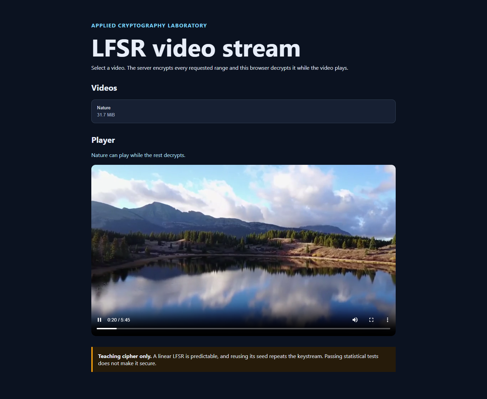

# LFSR Video Stream

An educational video streaming project exploring synchronous stream ciphers. A Flask server encrypts requested video ranges with a 16-bit LFSR, and a browser service worker decrypts them during playback and seeking. The project also compares LFSR, NLFSR, and Geffe generators using performance measurements and statistical tests.



## Features

- Video playback and seeking through encrypted byte-range requests.
- Matching Python and JavaScript LFSR implementations.
- NLFSR and Geffe generators for comparative experiments.
- NistRng statistical evaluation and automated cipher, server, and browser contract checks.

**Educational use only.** A 16-bit linear LFSR is predictable and unsuitable for protecting real data. This demonstration does not provide production-grade confidentiality or authentication; passing statistical tests does not make a cipher secure.

## Run

Python 3.11 or newer is required.

```bash
python -m venv .venv
.venv/bin/python -m pip install -r requirements.txt
.venv/bin/python -m stream_server --port 8000
```

Open <http://127.0.0.1:8000>, select a video, and press play when the first range is ready. Later ranges are decrypted during playback and seeking.

## Windows / PowerShell

```powershell
python -m venv .venv
.\.venv\Scripts\python.exe -m pip install -r requirements.txt
.\.venv\Scripts\python.exe -m stream_server --port 8000
```

## Verification and evaluation

Node.js is required for the JavaScript/browser contract tests.

```powershell
.\.venv\Scripts\python.exe -m unittest discover -s tests -v
.\.venv\Scripts\python.exe -m tools.evaluate
```

The evaluation runs the complete NistRng battery on equally sized LFSR, NLFSR,
and Geffe outputs. The full battery can take several minutes. Statistical
results do not establish cryptographic security.

Each statistical test receives its own copy of the bit sequence because
NistRng's matrix-rank test modifies its input. A regression test checks that
running matrix rank cannot change a later monobit result. NistRng selects the
non-overlapping template randomly, so that test may vary between runs.

## Project layout

- `stream_cipher.py`: LFSR transition, keystream generation, and XOR encryption.
- `web/cipher.js`: matching JavaScript implementation for browser decryption.
- `cipher_variants.py`: nonlinear feedback and Geffe generators.
- `stream_server.py`: encrypted video range API.
- `tools/`: performance and statistical evaluation.
- `tests/`: cipher, server, browser, and evaluation checks.
- `assets/`: playback screenshot used in this README.

## Credits and provenance

This project is based on [seyed0123/secure_video_steam](https://github.com/seyed0123/secure_video_steam), the starter repository linked on page 4 of the assignment handout. Credit for the original application framework and exercise scaffolding belongs to its contributors.

This version completes the cipher exercises in Python and JavaScript, implements the NLFSR and Geffe variants, adds verification coverage, isolates statistical test inputs to prevent mutation between tests, and updates the playback interface and documentation.

## License status

No license file or explicit license statement was found in the upstream repository when checked. This repository does not claim to relicense the upstream code or bundled media. Attribution is not a grant of permission; obtain the relevant rights holders' permission for reuse or redistribution where required. See [GitHub's licensing guidance](https://docs.github.com/en/repositories/managing-your-repositorys-settings-and-features/customizing-your-repository/licensing-a-repository).
